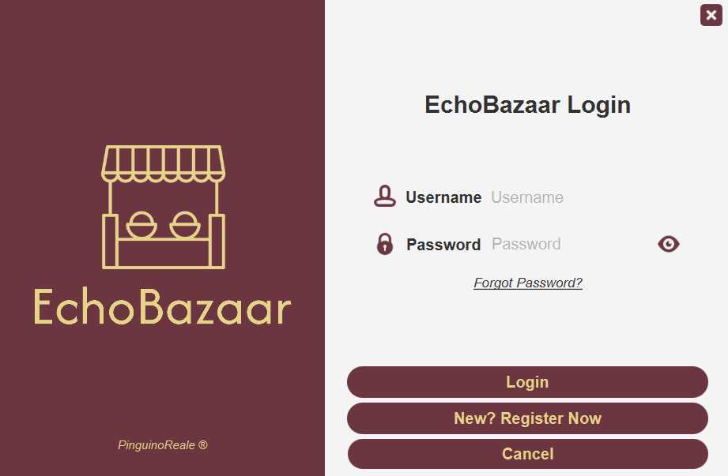
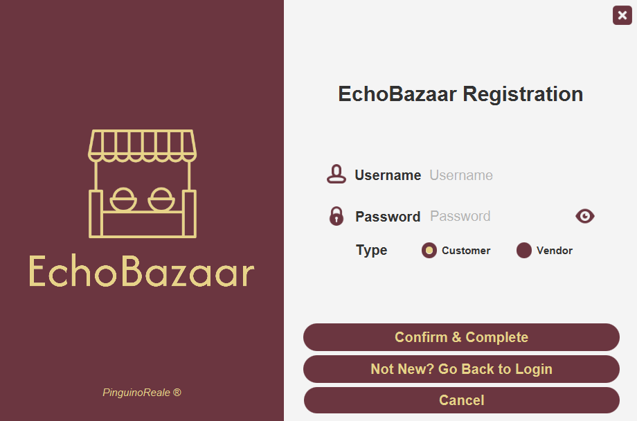
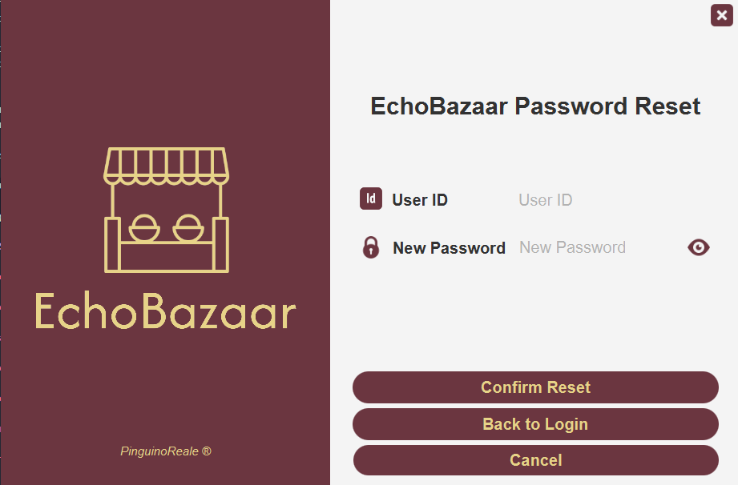
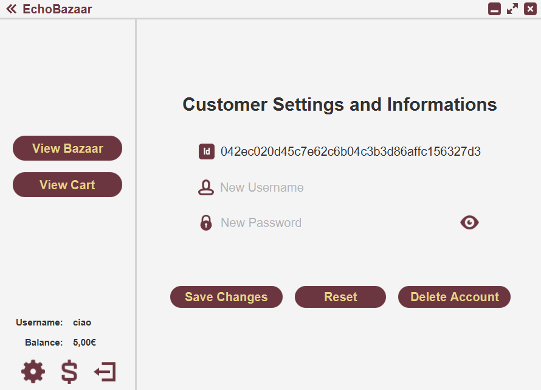
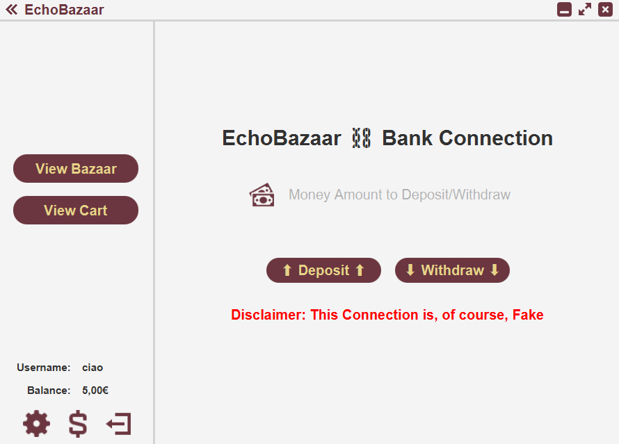
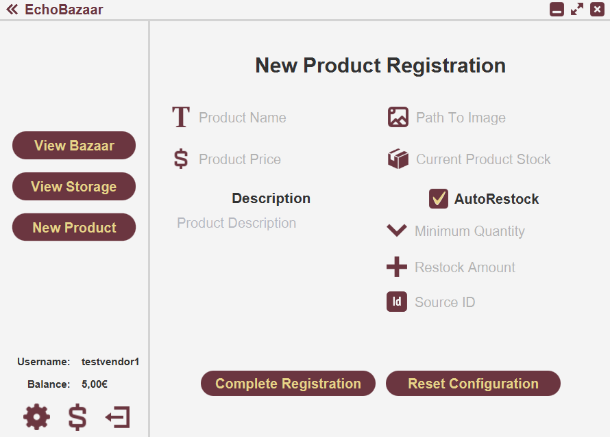
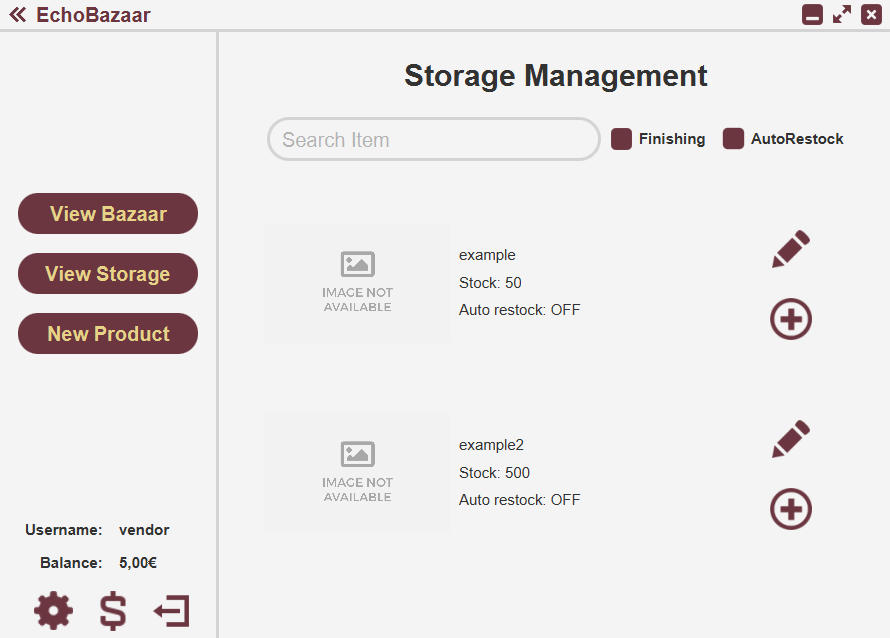
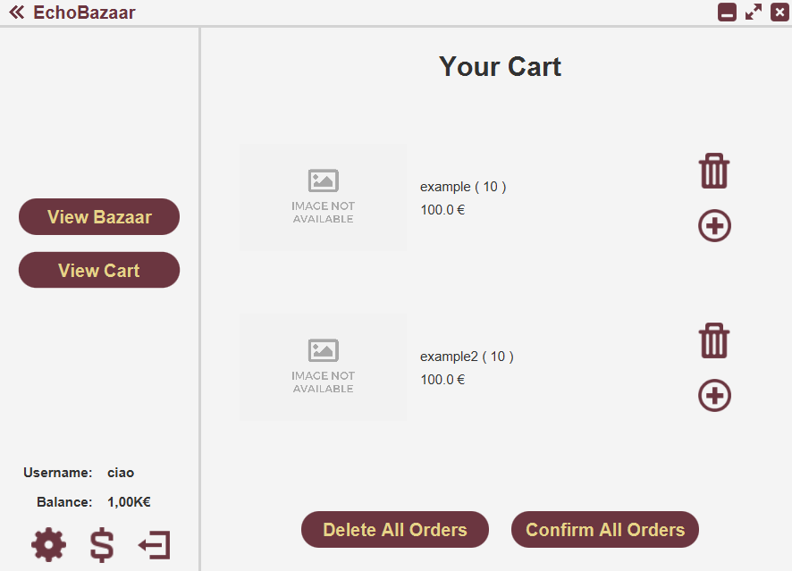
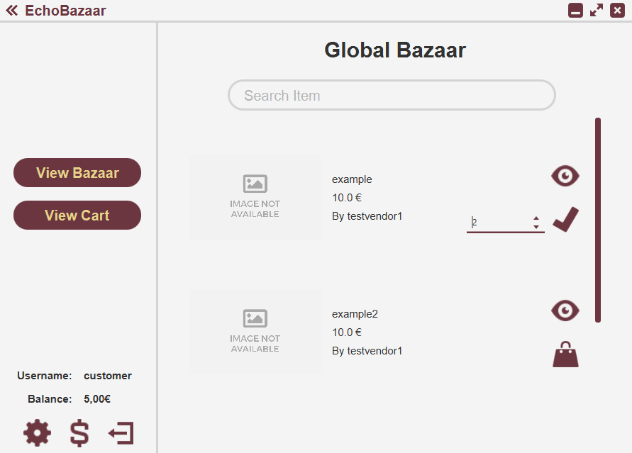
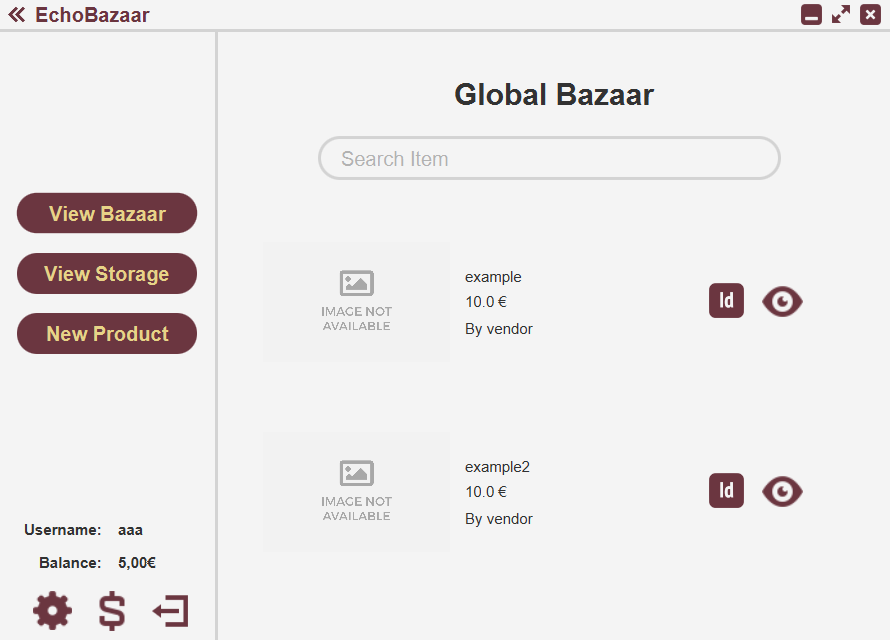

# EchoBazaar

JavaFX desktop application combining vendor inventory management with customer shopping in a unified marketplace, featuring automated restocking and inter-vendor product sourcing.

## Table of Contents

- [Features](#features)
- [Screenshots](#screenshots)
- [Project Structure](#project-structure)
- [Setup](#setup)
- [Run](#run)
- [Usage](#usage)
- [Configuration](#configuration)
- [Tech Stack](#tech-stack)
- [Support](#support)
- [Licence](#licence)
- [Author](#author)

## Features

- **Authentication:** Sign in on the login screen with a username and password so each account and its balance stay private. Passwords are hashed with SHA-1 before storage and compared as hashes, so the data files never contain plain-text passwords. Press Enter in the password field to submit.
- **Password recovery:** Reset a forgotten password from the login screen by entering the account ID and a new password of at most 12 characters, so access can be regained without an email service. The account ID is displayed and can be copied from the account settings. The reset requires no other proof of ownership, so an account ID acts as a reset secret.
- **Dual account types:** Register on the registration screen as a customer to shop or as a vendor to sell, because the two roles use different workflows. Usernames are unique across both account types and are validated by the registration form (12-character limit; spaces and a fixed set of punctuation characters are rejected).
- **Account management:** From the settings view, change the username and/or password, copy the account ID, and delete the account so credentials stay current and accounts can be removed. Deletion requires a second click within five seconds. Deleting a vendor also deletes every product it owns; products sourced from a deleted product lose their automatic-restocking link and become standalone products.
- **Balance management:** From the bank view, check the balance, deposit funds and withdraw funds in euros to pay for purchases. New accounts start with 5 €. A withdrawal is rejected when the amount exceeds the balance. The balance is stored with the account and is used for every purchase.
- **Product registration:** From the vendor page, register a product with a name, description, price, current stock, optional image and optional automatic restocking so it appears in the vendor's storage and in the Global Bazaar. Prices must be greater than zero, stock cannot be negative, descriptions are limited to 250 characters and cannot contain `,` or `|`, and names reject the same punctuation as usernames. The image chooser lists PNG and JPEG files; the image must not exceed the placeholder image's dimensions and is copied into `src/main/resources/user_images/`.
- **Storage management:** In the storage view, search owned products by name or description, filter the list to products with automatic restocking, edit or delete products (deletion requires a second click within five seconds), and add stock so listings and availability stay accurate. For a product without automatic restocking, added stock is free; for an automatic-restocking product, the entered quantity is bought from the source vendor at the source product's price. The image cannot be changed after registration.
- **Inter-vendor sourcing:** From the View Bazaar button on the vendor page, browse and search the products of other vendors, open their details and copy a product ID, because automatic restocking needs the ID of a product to buy from. This view does not sell directly.
- **Automatic restocking:** Enable it on the product registration or edit form by setting a minimum stock, a restock amount and the ID of a product owned by another vendor, so stock is replenished without manual intervention. When a sale leaves stock below the minimum, the application buys the restock amount of the source product from its vendor and adds it to stock; the buyer pays the source price. The restock fails, leaving stock unchanged, when the source stock or the buyer's balance is insufficient. The source product's own automatic-restocking rule is then applied in turn.
- **Global Bazaar browsing:** From the View Bazaar button on the customer page, browse every product from every vendor, search by name or description, and open product details with the description, price and owner so they can compare and choose what to buy. Vendors see the same catalogue minus their own products in the inter-vendor view.
- **Shopping cart:** From a product card or the product details view, add between 1 and 100 units of a product so a purchase can span several vendors; stock and balance are checked when adding. Remove individual orders or empty the cart. Checkout pays every order, decrements stock, credits each vendor and applies automatic restocking; it is rejected when the cart is empty or the total exceeds the balance. The cart lives in memory only and is cleared on logout or account deletion.
- **Local persistence:** Every change is written immediately to comma-separated text files under `src/main/resources/data/`, which are loaded at startup, so the marketplace survives restarts without a database or network connection.

## Screenshots

**Login**



**Registration**



**Password Reset**



**Modify User**



**Deposit / Withdrawal**



**Product Registration**



**Storage Management**



**View Cart**



**Global Bazaar (Customer)**



**Global Bazaar (Vendor)**



## Project Structure

```text
EchoBazaar/
├── src/
│   └── main/
│       ├── java/
│       │   ├── auth/                    # SHA-1 password hashing
│       │   ├── controllers/             # JavaFX controllers (10 classes)
│       │   ├── model/                   # DataHandler, Product, ProductOrder
│       │   │   └── users/               # Customer and Vendor
│       │   └── Main.java                # JavaFX entry point (main.java.Main)
│       └── resources/
│           ├── css/commonStyle.css
│           ├── data/                    # customers.txt, products.txt, vendors.txt
│           ├── fxml/                    # 9 view layouts
│           └── images/                  # icons, logos and placeholder image
├── docs/
│   ├── classdiagOf_4_pinguinoReale_echoBazaar.uxf
│   ├── usecaseOf_4_pinguinoReale_echoBazaar.uxf
│   ├── pinguinoReale_echoBazaar.pptx
│   └── images/                          # screenshots used in this README
├── AGENTS.md
├── LICENSE
└── README.md
```

The code is organised in layers:

- `auth/` hashes passwords with SHA-1.
- `controllers/` holds one JavaFX controller per FXML view, plus the shared `Controller` base class.
- `model/` holds in-memory lists, text-file persistence and the product and order types.
- `model/users/` holds the customer and vendor account types.
- `resources/` holds FXML layouts, CSS, images and the seed data files.
- `docs/` holds the UML diagrams, the presentation and the screenshots.

The code also expects `src/main/resources/user_images/` as the destination for registered product images. That directory is not present in the repository; see [Configuration](#configuration).

## Setup

**Prerequisites**

- JDK 21 or newer.
- A JavaFX SDK (Gluon) compatible with the JDK. The repository has no dependency manager and does not bundle JavaFX.
- An IDE such as IntelliJ IDEA, Eclipse or VS Code, or the JDK command-line tools.

**Installation**

1. Clone the repository:

   ```bash
   git clone https://github.com/LorenBll/EchoBazaar.git
   cd EchoBazaar
   ```

2. Open the repository root in the IDE and configure the project manually. The repository contains no `pom.xml`, `build.gradle`, `.idea` or `.classpath` file, so the IDE does not infer the setup.

3. Mark `src` as the source root (Eclipse source folder, IntelliJ Sources Root). The Java packages start with `main.java` and the views are loaded as `/main/resources/...`, so `src` must be both the source and resource root. Do not mark `src/main/resources` separately as a resource root, or the `main/resources` prefix is lost from the classpath.

4. Add the JavaFX SDK `lib` directory to the module path and add the modules `javafx.controls` and `javafx.fxml`.

5. Set the working directory to the repository root. `DataHandler` opens `src/main/resources/data/*.txt` relative to the working directory.

6. Create `src/main/resources/user_images/` before registering products with images. The code does not create this directory.

7. Run the main class `main.java.Main`.

## Run

Start the application by running `main.java.Main` with the module path and working directory configured as described in [Setup](#setup). The application opens the login screen in an undecorated, non-resizable window with custom minimise, fullscreen and close buttons.

The repository contains no `run.bat`, `run.sh`, Maven wrapper or Gradle wrapper, so there is no scripted start and no `--debug` option.

To build and run from PowerShell without an IDE, execute the following from the repository root, replacing `<javafx-sdk>` with the extracted SDK path:

```powershell
javac --module-path "<javafx-sdk>\lib" --add-modules javafx.controls,javafx.fxml -d out (Get-ChildItem -Path src -Recurse -Filter *.java).FullName
New-Item -ItemType Directory -Force out\main\resources | Out-Null
Copy-Item -Path src\main\resources\* -Destination out\main\resources -Recurse -Force
java --module-path "<javafx-sdk>\lib" --add-modules javafx.controls,javafx.fxml -cp out main.java.Main
```

The application resolves `src/main/resources/data` against the working directory, so starting it elsewhere uses a different data directory or fails to find one.

## Usage

1. Start the application and log in with an existing account, register a new customer or vendor, or reset a password with an account ID.
2. **For vendors:**
   - Open the settings view to copy the vendor ID and balance, change credentials, or delete the account.
   - Register products with their price, stock, description and optional image or automatic-restocking settings.
   - Use the storage view to search, edit, delete and replenish products.
   - Use the inter-vendor view to find another vendor's product and copy its ID for the source ID field.
   - Use the bank view to deposit or withdraw funds.
3. **For customers:**
   - Browse the Global Bazaar and search for products.
   - Add products and quantities to the cart, then remove orders or empty the cart as needed.
   - Check out to pay for every order in the cart.
4. Close the window with the custom close button; account, product and balance changes are already saved in the data files.

The bundled data files contain sample records: one customer, two vendors and three products. Replace or delete them as needed; the application recreates an empty file only when a data file is missing.

## Configuration

EchoBazaar reads no properties file, `.env` file or external configuration. The following hard-coded values act as configuration.

| Setting | Value | Effect |
| --- | --- | --- |
| Working directory | Repository root | The text data files and the product-image copy destination are resolved relative to it. |
| Data directory | `src/main/resources/data/` | Holds `customers.txt`, `vendors.txt` and `products.txt`. Missing files are created; every change rewrites the affected file. |
| Data format | One comma-separated record per line | Account records hold username, ID, password hash, balance and, for vendors, product IDs. Product records hold ID, vendor ID, name, quoted description, image path, price, stock and automatic-restocking fields. |
| Product image directory | `src/main/resources/user_images/` | Destination for images copied during registration. The directory must exist; it is absent from the repository, and registration reports `Invalid Image.` when the copy fails. The stored path is loaded from the classpath, so a compiled `out` directory needs the new file copied or a rebuild before the image is displayed. |
| Starting balance | `5` | Initial balance in euros for every new customer and vendor. |
| Username | 1–12 characters | Must be non-empty, contain no spaces and avoid `\`, a vertical bar, `!`, `@`, `#`, `$`, `%`, `^`, `&`, `*`, `(`, `)`, `+`, `{`, `}`, `:`, `"`, `<`, `>`, `?`, `[`, `]`, `;`, `'`, `,` and `.`. Enforced at registration; when changing credentials, an empty field keeps the current username. |
| Password | 1–12 characters | Must be non-empty at registration and reset; may be left empty when changing credentials to keep the current password. |
| Product name | Non-empty, restricted punctuation | No length limit; must avoid the same punctuation set as usernames. |
| Product description | 1–250 characters | Must be non-empty and cannot contain a comma or a vertical bar. |
| Product price | Greater than `0` | Parsed as a float; invalid or non-positive values are rejected. |
| Current stock | `0` or greater | Parsed as an integer; negative values are rejected. |
| Automatic restocking | Off by default | When enabled, requires a minimum stock and restock amount of `0` or greater, plus a source ID that exists, belongs to another vendor and, when editing, is not the product itself. |
| Product image | At most the placeholder dimensions | The bundled `iconOf_noImage.png` is 1280×822 pixels; larger images are rejected. |
| Cart quantity | 1–100 per order | Spinner range when adding a product; the default is 1. |
| Stock addition quantity | 0–10000 | Spinner range when replenishing a product; the initial value is 5, it resets to 1 after each operation and 0 cancels. |
| Password hash | SHA-1, lowercase hexadecimal | Applied to every stored password; the data files contain the hash, never the plain text. |

## Tech Stack

- **Language:** Java 21
- **UI framework:** JavaFX with FXML
- **Architecture:** MVC (Model-View-Controller)
- **Build tool:** None in the repository; compilation is IDE-based or manual with `javac`
- **UI design:** FXML layouts and CSS styling
- **Data storage:** Plain comma-separated text files
- **External services:** None

## Support

Report issues at <https://github.com/LorenBll/EchoBazaar/issues>.

## Licence

Released into the public domain under the Unlicense. See [LICENSE](LICENSE) and <https://unlicense.org>.

## Author

[LorenBll](https://github.com/LorenBll)
